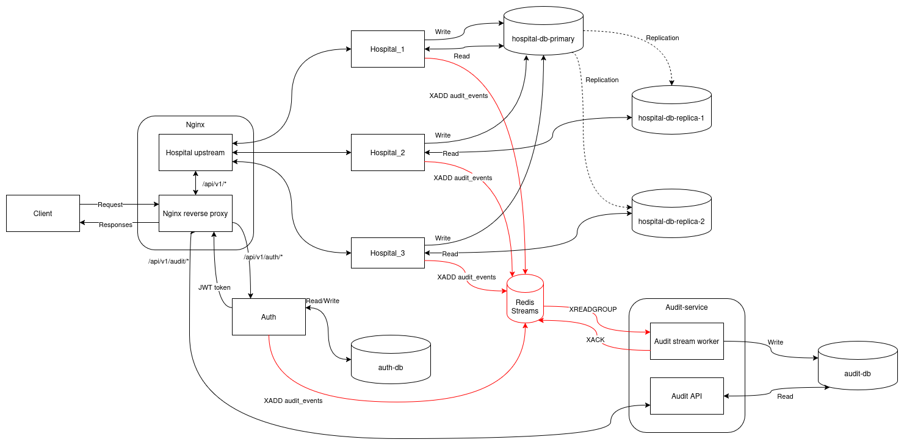

# Distributed Systems – Electronic Health Records (EHR)

A distributed microservice-based Electronic Health Records system built as a course project for the Distributed Systems course. The project consists of three independent services: Hospital, Auth, and Audit. Traffic is routed through an Nginx reverse proxy. Data is stored in PostgreSQL databases, and Redis Streams are used for event streaming between nodes.

## Architecture Overview



## Prerequisites

Make sure the following are installed on your system:

- **Docker**
- **Docker Compose**
- **Postman (for testing)**

> **No other local dependencies (Node.js, Python, etc.) are required.** Everything runs inside Docker containers.

## Running the Application

The entire system is orchestrated with a single Docker Compose file. To start all services, run the following command in the project root directory:

```bash
docker compose -f docker-compose.dev.yml up --build
```

This will build and start:

- 3 × Hospital API instances
- 1 × Auth service
- 1 × Audit service
- 1 × Nginx reverse proxy (exposed on **port 8080**)
- 1 × Redis instance
- 5 × PostgreSQL databases (hospital primary, 2 hospital replicas, auth DB, audit DB)

Once everything is up, the API is accessible through the Nginx reverse proxy at:

```
http://localhost:8080
```

### API Routes (via Reverse Proxy)

All requests go through `http://localhost:8080`:

| Route prefix | Routed to |
|---|---|
| `/api/v1/auth/*` | Auth service |
| `/api/v1/audit/*` | Audit service |
| `/api/v1/*` (everything else) | Hospital service (load-balanced) |

### Stopping the Application

```bash
docker compose -f docker-compose.dev.yml down
```

To also remove all persisted database volumes:

```bash
docker compose -f docker-compose.dev.yml down -v
```

## Testing the application

To explore and test the API endpoints, a Postman collection is provided in the `postman` directory. You can import this directly into Postman to get immediate access to all available routes.

## Environment Variables

> **Note:** All environment variables are intentionally defined directly inside `docker-compose.dev.yml` rather than in external `.env` files. This is done **on purpose for development** to allow anyone to quickly clone the repository and spin up the full environment on any machine without additional configuration.

## Default Credentials

The development setup seeds an admin user on first startup:

| Field | Value |
|-------|-------|
| Email | `admin@hospital.com` |
| Password | `admin` |
